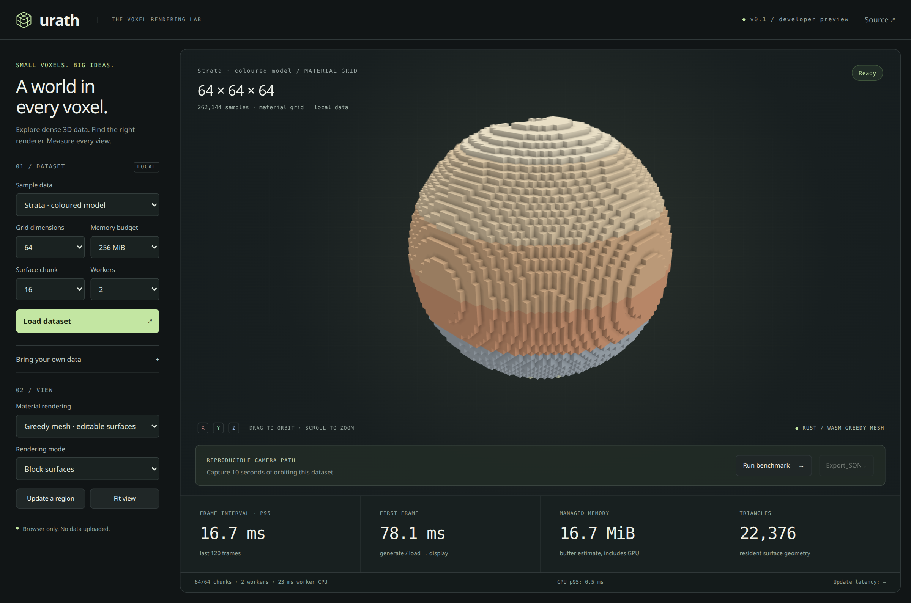
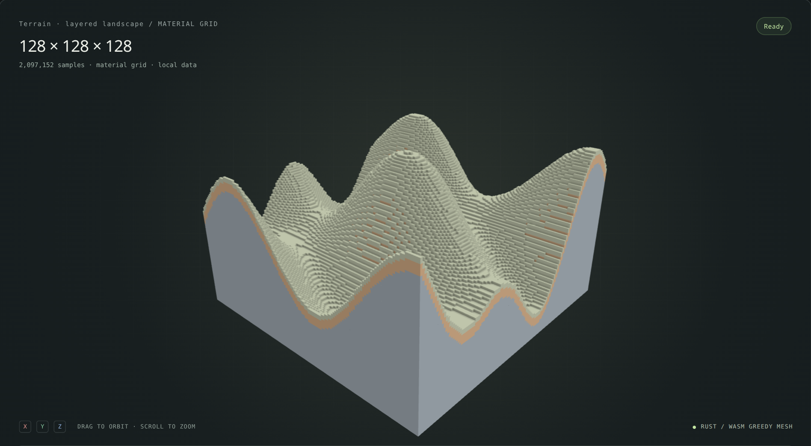
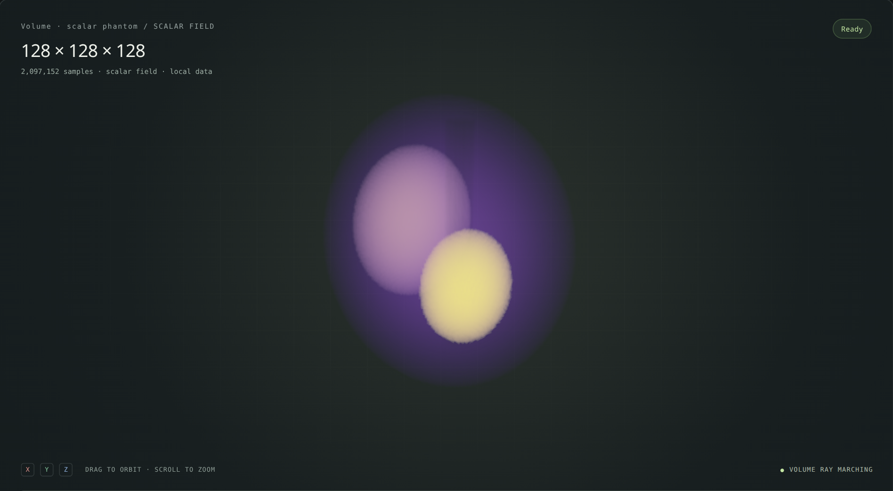

<p align="center">
  
</p>
<h1 align="center">urath</h1>
<p align="center"><strong>A world in every voxel.</strong><br />High-performance voxel and volume rendering for the browser.</p>
<p align="center">Rust · WebAssembly · TypeScript · Three.js</p>
<p align="center">
  <a href="#try-the-lab">Try the lab</a> ·
  <a href="packages/urath/README.md">API guide</a> ·
  <a href="docs/performance-storage.md">Performance measurements</a>
</p>



Urath turns typed arrays into interactive 3D views. Mesh editable block worlds, trace dense material grids directly on the GPU, or explore scalar data with transfer functions and clipping. Bring your own Three.js scene, camera, and render loop.

**Developer preview.** The API, working lab, tests, and reproducible benchmarks live here. Build a local npm package to integrate it today; these instructions do not require a published registry release.

## Data worth exploring

<table>
  <tr>
    <td width="50%"></td>
    <td width="50%"></td>
  </tr>
  <tr>
    <td><strong>Editable surfaces</strong><br />Greedy geometry, material colours, and ambient occlusion.</td>
    <td><strong>Scalar volumes</strong><br />Transfer functions, clipping, and an isosurface view.</td>
  </tr>
</table>

_Actual Chromium captures of the production demo, using generated fixtures. The figures in screenshots are live observations, not portable benchmark claims. [Capture settings and reproduction](docs/images/README.md)._

## Choose a rendering path

| Your data                                   | API                    | How it works                                                                                                          |
| ------------------------------------------- | ---------------------- | --------------------------------------------------------------------------------------------------------------------- |
| Editable block worlds and coherent surfaces | `createSurface()`      | Rust/WASM greedy meshing in workers. Neighbour-aware chunk updates, packed geometry, bounded scheduling.              |
| Dense or fragmented opaque grids            | `createVoxelRaycast()` | Exact first-hit GPU traversal. One draw call, without generating a mesh for every exposed face.                       |
| Density, intensity, and other scalar fields | `createVolume()`       | GPU ray marching with hierarchical empty-space skipping, volume and isosurface modes, and native 8/16/32-bit storage. |

Every path accepts typed arrays, dimensions, voxel spacing, a world origin, and an explicit memory budget. All expose resource statistics, regional updates, and disposal. Data stays in the browser.

## Try the lab

From this checkout, with Node.js 20.11+ and a stable Rust toolchain installed:

```sh
rustup target add wasm32-unknown-unknown
npm ci
npm run build
npm run dev
```

Open the printed Vite URL. Choose a fixture or import a raw little-endian file with explicit dimensions and spacing. The lab includes layered models, terrain, noisy material grids, and a scalar phantom.

- **Inspect:** orbit, zoom, fit the camera, change the rendering path, and clip scalar volumes.
- **Edit:** update a region and measure how quickly it becomes visible.
- **Measure:** record a repeatable 10-second orbit and export frame, CPU, GPU, memory, dataset, and device information as JSON.

The lab uses the public package API throughout. It has no separate rendering implementation.

## Use it in your application

Build once using the steps above, then create the distributable:

```sh
mkdir -p artifacts
npm pack -w @urath/threejs --pack-destination artifacts

# In your application:
npm install /path/to/urath/artifacts/urath-threejs-0.1.0.tgz three@0.172.0
```

The archive includes JavaScript, TypeScript declarations, workers, and WASM. **Consumers do not need Rust.**

```ts
import { createSurface } from "@urath/threejs";

const surface = await createSurface({
  data: new Uint16Array(32 ** 3).fill(1),
  dimensions: [32, 32, 32],
  maxMemoryBytes: 256 * 1024 * 1024,
});
scene.add(surface); // Your existing Three.js scene.

await surface.updateRegion({
  offset: [12, 12, 12],
  dimensions: [8, 8, 8],
  data: new Uint16Array(8 ** 3), // Carve out a region.
});

// Release workers, CPU buffers, and GPU resources when finished.
surface.dispose();
```

The [API guide](packages/urath/README.md) covers all three renderers, scalar transfer functions, memory ownership, storage promotion, cancellation, and failure behaviour.

## Performance, with the conditions attached

These are GPU p95 measurements for **512³ grids at a 1024 × 1024 render target**, on AMD integrated graphics through ANGLE/Vulkan in Chromium 143. They measure GPU draws, not complete application frames.

| Workload                                    | GPU p95, close-up |
| ------------------------------------------- | ----------------: |
| Dense opaque materials, 50% noisy occupancy |       **2.51 ms** |
| Sparse opaque materials                     |       **5.15 ms** |
| Sparse scalar volume                        |       **6.82 ms** |

Native integer scalar storage cuts scalar-buffer memory by **75% for Uint8** and **50% for Uint16** compared with Float32 storage. On the dense translucent stress fixture, close-up GPU p95 falls from about **213 ms to 140–143 ms**. Optional Float32 transfer caching reaches **138 ms**, with extra memory and preparation cost.

**Deeply translucent 512³ fields remain expensive.** Those dense timings are not real-time on the tested GPU. Workload, camera, opacity, quality, resolution, and hardware all matter. Memory statistics estimate managed buffers, not total browser or driver memory.

Read the [512³ stress methodology](docs/performance-stress.md), [storage experiments and tradeoffs](docs/performance-storage.md), and [earlier surface optimizations](docs/performance.md). Raw captures accompany the reports.

```sh
URATH_BENCH_GPU=1 npm run benchmark
URATH_BENCH_GPU=1 URATH_STRESS_SIZE=512 npm run benchmark:stress
```

Check the device recorded in each report: requesting a hardware backend does not guarantee one. Omit `URATH_BENCH_GPU=1` for software-rendered smoke measurements.

## Verify and contribute

```sh
cargo test --workspace
cargo fmt --all -- --check
cargo clippy --workspace --all-targets -- -D warnings
npm run typecheck
npm test
npx playwright install chromium
npm run test:browser
npm run test:package
```

Build first. Browser tests exercise real WASM workers, rendering, regional uploads, budgets, and resource lifecycles. The package test installs the archive in an independent TypeScript/Vite application and verifies its production build under `/nested/` without Rust in the consumer. Native mesher benchmarks run with `cargo bench -p urath`.

| Path                | Responsibility                                              |
| ------------------- | ----------------------------------------------------------- |
| `crates/urath-core` | Rust chunk data, meshing, and terrain generation            |
| `crates/urath-wasm` | WASM bindings and reusable worker meshing sessions          |
| `packages/urath`    | Typed API, Three.js adapters, GPU renderers, and scheduling |
| `examples/demo`     | Interactive performance lab and deterministic fixtures      |
| `tests/browser`     | Browser integration and rendering correctness               |
| `scripts`           | Benchmarks, package verification, and screenshot capture    |

## Current boundaries

Datasets must fit in resident memory. Streaming, adaptive level of detail, and WebGPU are not implemented. Scalar sampling is nearest-neighbour; compositing opaque geometry inside a translucent volume needs additional depth integration. Surface ambient occlusion uses face neighbours rather than a complete diagonal halo. See the [API limitations](packages/urath/README.md#scope) before choosing a path.

The low-level WASM API remains available through `@urath/threejs/wasm/urath_wasm.js`; its result objects require `.free()` and differ from the reusable surface-worker API.

Rust crates: [MIT](LICENSE-MIT) OR [Apache-2.0](LICENSE-APACHE). JavaScript package and viewer: [MIT](LICENSE-MIT).
